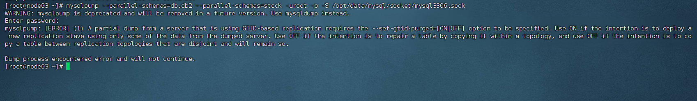

# 使用mysqlpump进行并行备份_v20250927.md

首先申明， mysqlpump 后期会被移除。不建议花太多的时间深入学习，只需要了解基本的使用即可。 


## 备份特定的表

```shell
$> mysqlpump  --parallel-schemas=db  --parallel-schemas=db2 --parallel-schemas=stock --set-gtid-purged=OFF -uroot -p -S /opt/data/mysql/socket/mysql3306.sock > /opt/data/mysqlbackup/backup/database/stock/20250927/stock.sql
```


### 使用mysqlpump备份用户

```shell
$>  mysqlpump --exclude-databases=% --set-gtid-purged=OFF  --users -uroot -p -S /opt/data/mysql/socket/mysql3306.sock > /opt/data/mysqlbackup/backup/database/pump/stock/20250927/user.sql
```


### 加载后创建索引

```shell
[root@node03 socket]# mysqlpump --parallel-schemas=stock --set-gtid-purged=off -uroot -p -S /opt/data/mysql/socket/mysql3306.sock  > /opt/data/mysqlbackup/backup/database/pump/stock/20250927/stock_v1.sql
WARNING: mysqlpump is deprecated and will be removed in a future version. Use mysqldump instead.
Enter password: 
Dump progress: 1/2 tables, 0/2 rows
Dump progress: 34/35 tables, 195245/368485 rows
Dump completed in 1915

[root@node03 socket]# mysqlpump --parallel-schemas=stock --set-gtid-purged=off --skip-defer-table-indexes  -uroot -p -S /opt/data/mysql/socket/mysql3306.sock  > /opt/data/mysqlbackup/backup/database/pump/stock/20250927/stock_v2.sql
WARNING: mysqlpump is deprecated and will be removed in a future version. Use mysqldump instead.
Enter password: 
Dump progress: 1/2 tables, 0/2 rows
Dump progress: 34/35 tables, 178495/368485 rows
Dump completed in 1985

```


## 疑惑点


## 问题

### 问题一



[root@node03 ~]# mysqlpump --parallel-schemas=db,db2 --parallel-schemas=stock -uroot -p -S /opt/data/mysql/socket/mysql3306.sock  
WARNING: mysqlpump is deprecated and will be removed in a future version. Use mysqldump instead.
Enter password: 
mysqlpump: [ERROR] (1) A partial dump from a server that is using GTID-based replication requires the --set-gtid-purged=[ON|OFF] option to be specified. Use ON if the intention is to deploy a new replication slave using only some of the data from the dumped server. Use OFF if the intention is to repair a table by copying it within a topology, and use OFF if the intention is to copy a table between replication topologies that are disjoint and will remain so.

Dump process encountered error and will not continue.

解决方法：更加自己备份数据的用途，设置--set-gtid-purged参数的取值


### 问题二

[root@node03 ~]# mysqldump --parallel-schemas=db  --parallel-schemas=db2 --parallel-schemas=stock --set-gtid-purged=OFF -uroot -p -S /opt/data/mysql/socket/mysql3306.sock > /opt/data/mysqlbackup/backup/database/stock/20250927/stock.sql
mysqldump: [ERROR] unknown variable 'parallel-schemas=db'.

原因：parallel-schemas 是mysqlpump 命令的参数


## 其它知识


## TODO


## 变更记录

| 日期              | 类型 | 操作内容                 | 备注                   | 接下来验证的内容                       | 操作用户 |
| ----------------- | ---- | ------------------------ | ---------------------- | -------------------------------------- | -------- |
| 2024-04-13 星期六 | C    | 练习pg_dump命令          | xxx                    | pg_dump 一些参数使用存在疑惑，需要解决 | lipf     |
| 2024-04-13 星期六 | U    | 修改模板，新增一个类型列 | 用来说明修改文件的原由 |                                        | lipf     |
| 2025-05-19 星期一  | A     | 新增一个其他知识的章节，记录学习过程中了解到的和主题关系不大的知识 |                        |                                        |          |
|                   |      |                          |                        |                                        |          |

类型说明： C：创建    A： 最近内容    U：修改内容     R：解决疑惑点

